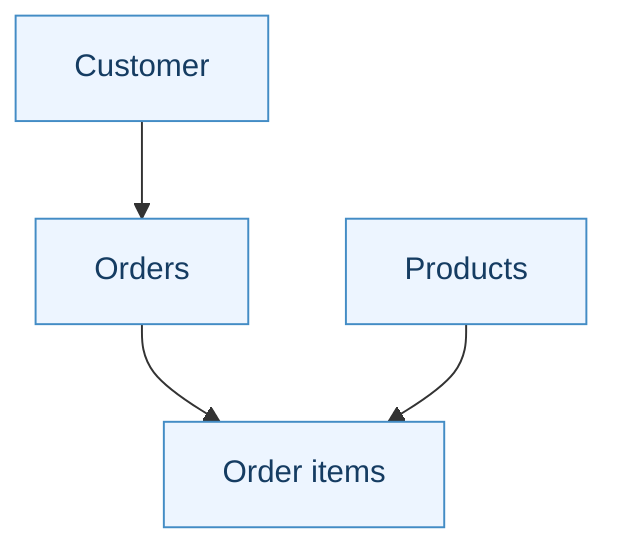
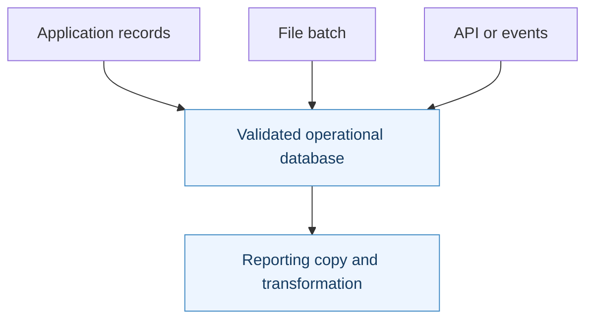
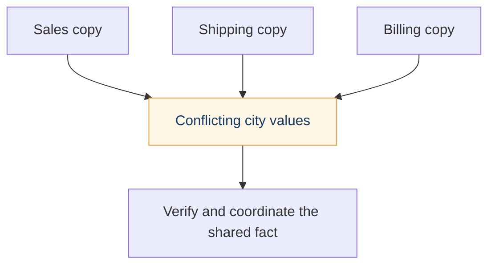
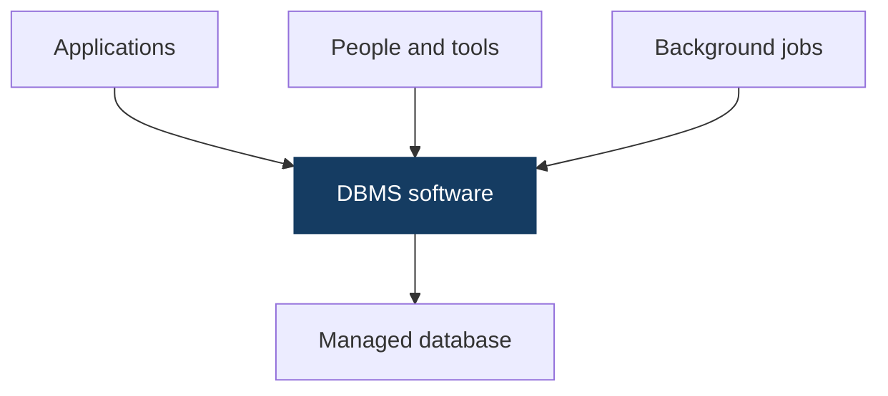
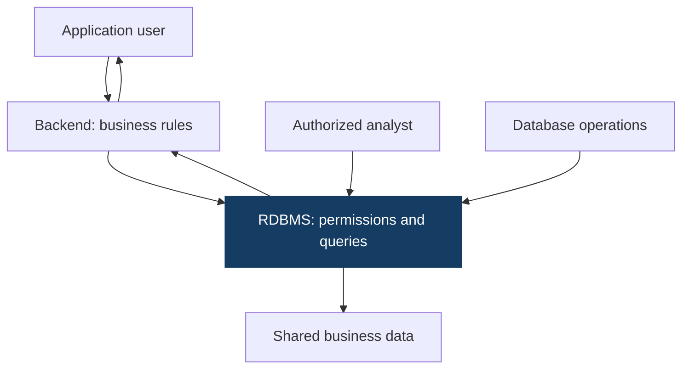
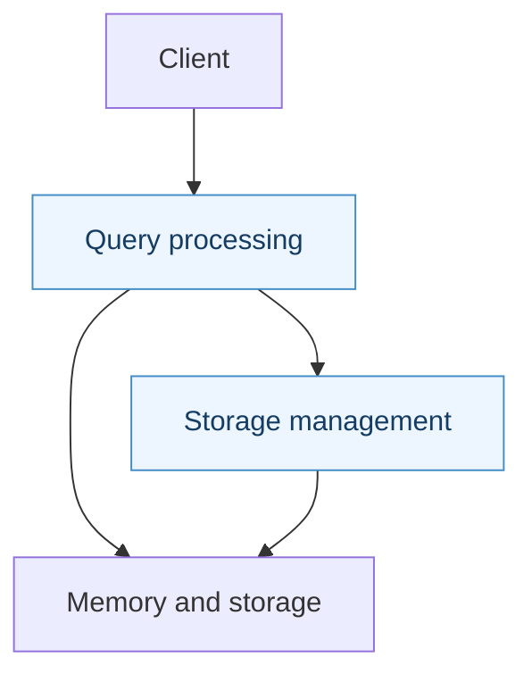

# Day 01 · Data, Database & SQL Foundations

**SQL Mastery Notebook · Microsoft SQL Server / T-SQL · Venkata Siva**

> Learn the meaning of data before memorising SQL. Follow one online-store example from data and context to your first SELECT.

**Data → Databases → SQL → Your first SELECT · Beginner-friendly explanations**

This GitHub edition uses native callouts, tables and editable Mermaid diagrams. The matching [PDF](SQL-Day-01-Foundations.pdf) provides the designed page layout; the [HTML](SQL-Day-01-Foundations.html) adds local interactive demos. Those links work when the three files are kept together.

<details>
<summary><strong>Open the reading map</strong></summary>

- [01 · Your Day 1 learning path](#topic-01)
- [02 · Data becomes useful when it has meaning](#topic-02)
- [03 · Three forms of data, with everyday examples](#topic-03)
- [04 · Entities, attributes and identifiers](#topic-04)
- [05 · Grain: say what one row represents](#topic-05)
- [06 · Metadata tells you how to read a value](#topic-06)
- [07 · Good structure does not guarantee good data](#topic-07)
- [08 · NULL, zero and empty text are different](#topic-08)
- [09 · Where data comes from and where it goes](#topic-09)
- [10 · Why files alone can become difficult](#topic-10)
- [11 · Database, DBMS, RDBMS and SQL](#topic-11)
- [12 · Why SQL and relational databases emerged](#topic-12)
- [13 · Read a table across and down](#topic-13)
- [14 · Data types: represent the right kind of value](#topic-14)
- [15 · Relationships connect facts; constraints protect rules](#topic-15)
- [16 · Transactions and OLTP: daily business work](#topic-16)
- [17 · OLTP and analytics answer different questions](#topic-17)
- [18 · SQL describes the work you want](#topic-18)
- [19 · SQL Server is the engine; SSMS is the client](#topic-19)
- [20 · How applications and people use the database](#topic-20)
- [21 · The engine uses memory and persistent storage](#topic-21)
- [22 · What happens when SELECT executes?](#topic-22)
- [23 · Written SQL and its meaning are different](#topic-23)
- [24 · Prepare the practice table once](#topic-24)
- [25 · Run your first SELECT and read the result](#topic-25)
- [26 · Choose columns without changing the table](#topic-26)
- [27 · First-day habits and common mistakes](#topic-27)
- [28 · The memory map: connect roles before terms](#topic-28)
- [29 · Interview room: data and database foundations](#topic-29)
- [30 · Interview room: SQL and query behavior](#topic-30)
- [31 · Technical vocabulary in one glance](#topic-31)
- [32 · Sources and reading beyond Day 1](#topic-32)
- [33 · Final practice: explain, predict and write](#topic-33)
- [34 · Answer guide: data and database reasoning](#topic-34)
- [35 · Answer guide: your first SQL queries](#topic-35)
- [36 · Your Day 1 completion checklist](#topic-36)

</details>

---

<a id="topic-01"></a>

## 01 · Your Day 1 learning path

**Today’s goal:** Understand the data, understand the database, and run a SELECT you can explain. We use one online store throughout.

| Step | Main question |
| --- | --- |
| 1. Data | What facts do we record, and what do they mean? |
| 2. Databases | Why keep related facts in a managed system? |
| 3. Relational structure | How do tables, types and relationships organize them? |
| 4. SQL and tools | How do people and applications request data? |
| 5. Query journey | What does the database engine do with the request? |
| 6. First SELECT | Can I predict, run and explain the result? |

> [!NOTE]
> **The reading pattern**
>
> Each lesson gives you a plain definition, a concrete example and a memory cue. Technical words appear next to their meaning. Learn the idea first; use the word once you can explain it.

**Read in blocks:** Begin with the data lessons. Take a break before databases. Finish with the SQL lab, interview explanations and independent practice. Allow roughly 3–4 hours with practice, or split the reading across sessions.

**Today’s SQL focus:** basic SELECT. Relationships and transactions are introductions; learn their purpose first. Day 2 adds filtering through IS NULL and IS NOT NULL.

**Lab:** The examples use Microsoft SQL Server / T-SQL. You need an existing SQL Server connection to execute them. The HTML activities are local teaching simulations.


---

<a id="topic-02"></a>

## 02 · Data becomes useful when it has meaning

**Data** is recorded facts: a name, a price, a date, a quantity. **Information** is the meaning we obtain when those facts answer a question.

| Visual element | Read it as |
| --- | --- |
| **DATA** | Asha \| Order 101 \| 500; Recorded facts |
| **QUESTION** | Which customer; placed this order? |
| **INFORMATION** | Asha placed Order 101; for 500 currency units |

- DATABASE: organized collection of related data.
- DBMS: software that stores, retrieves and manages that data.
- SQL: language used to ask for data or define changes in a relational system.

*Visual takeaway: Data plus context answers a business question.*

| Recorded fact | Context | What we learn |
| --- | --- | --- |
| 500 | Order 101 total, in INR | Order 101 costs INR 500 |
| Hyderabad | Asha’s current city | Asha’s profile lists Hyderabad |
| 2 | Quantity on an order line | Two units were ordered |

The same number can mean different things. “500” might be an amount, a quantity or an identifier. The field name, units and business definition tell us how to interpret it.

Our store records customers, products and orders. A **database** is an organized collection of related data and objects used to manage those facts.

> [!NOTE]
> **Memory cue**
>
> Data is the recorded fact. Context tells you what it means. Information answers a question.

**Interview phrase:** “Data becomes meaningful when I know its context, such as units, time and what the record represents.”


---

<a id="topic-03"></a>

## 03 · Three forms of data, with everyday examples

These forms describe **how the main content is organized**. They do not describe whether a value is text or a number.

| Visual element | Read it as |
| --- | --- |
| **STRUCTURED** | Defined record fields; Customer rows; Bank transactions |
| **SEMI-STRUCTURED** | Keys and nested values; JSON order response; XML invoice |
| **UNSTRUCTURED** | Free-form main content; Review text / delivery photo; Support-call audio |

- One business produces all three forms; classify the content, not the entire company.
- Free-form content can still have structured metadata such as a rating or customer ID.

*Visual takeaway: Fixed fields, keys and tags, or free-form content: three ways to organize data.*

| Form | Easy explanation | More examples |
| --- | --- | --- |
| Structured | Records follow defined fields | Bank transaction table; patient appointments; product price list |
| Semi-structured | Keys or tags describe values; records can be nested or flexible | JSON order response; XML invoice; JSON delivery event |
| Unstructured | Main content is free-form rather than our predefined record fields | Customer review; scanned prescription image; support-call audio |

### Structured: predefined record fields

A customer table gives every row named columns: CustomerID, CustomerName and City. A consistently defined CSV or spreadsheet can also contain structured data.

**Semi-structured: named keys and nesting**

```json
{"customerId": 1, "name": "Asha",
 "preferences": {"language": "English"}}
```

JSON is self-describing through keys and nesting. Different records can carry different fields; a schema can still validate them.

**Unstructured: free-form main content**

“Good product, but delivery was late” is review text. Its rating and customer ID can be structured fields alongside that text. An image also has a file format and metadata; unstructured does not mean completely without structure.

**Memory cue:** structured = fixed fields; semi-structured = keys or tags; unstructured = free-form main content.


---

<a id="topic-04"></a>

## 04 · Entities, attributes and identifiers

Before thinking about SQL syntax, identify the things your business records.

| Term | Plain meaning | Store example |
| --- | --- | --- |
| Entity | A thing or event we need to describe | Customer, product, order |
| Attribute | A property of that entity | Customer name or city |
| Identifier | A value that distinguishes one instance | CustomerID 1 |



*Visual takeaway: Customers place orders; each order has product lines.*

Asha is one customer. CustomerName and City describe her. CustomerID distinguishes her from another person who might also be called Asha.

An order is a different entity. It needs its own identifier and facts such as its date and customer reference. An order item represents a product line within that order.

> [!NOTE]
> **Memory cue**
>
> Entity: what is it? Attribute: what describes it? Identifier: which one is it?

Do not use a name as a unique identifier just because it looks unique in a small sample. Names can repeat and can change.


---

<a id="topic-05"></a>

## 05 · Grain: say what one row represents

**Grain** means the level of detail represented by one row. State it as a sentence before counting or adding anything.

| Visual element | Read it as |
| --- | --- |
| **ONE ROW PER ORDER** | OrderID \| OrderTotal; 101 \| 500; Order 101 is counted once |
| **ONE ROW PER ORDER ITEM** | OrderID \| Product \| LineAmount; 101 \| P1 \| 300; 101 \| P2 \| 200 |

- Correct line-level total for Order 101: 300 + 200 = 500.
- If the whole order total 500 is copied to both lines and summed: 500 + 500 = 1,000.
- The arithmetic is correct, but the meaning is wrong because the grain was mixed.

*Visual takeaway: One order row is different from two order-item rows.*

Order 101 contains a book costing 300 and a pen costing 200.

| Dataset | One row represents | Rows for this example |
| --- | --- | --- |
| Orders | One order | 1 row, total 500 |
| OrderItems | One product line in an order | 2 rows, amounts 300 and 200 |

If you copy the whole-order total 500 onto both item rows and add it, you get 1000. The arithmetic works; the business answer is wrong. Add the line amounts instead: 300 + 200 = 500.

> [!NOTE]
> **Memory cue**
>
> One row, one meaning. Counting rows only makes sense after you know that meaning.

**Interview phrase:** “I confirm the grain before counting, aggregating or joining data to avoid double counting.” You will learn aggregation and joins later.


---

<a id="topic-06"></a>

## 06 · Metadata tells you how to read a value

**Metadata** is information that describes data. It tells you what a field means and how to use it.

| Visual element | Read it as |
| --- | --- |
| **VALUE** | 500; A number on its own |
| **METADATA / CONTEXT** | OrderAmount; Currency: INR; OrderID: 101 |
| **INFORMATION** | Order 101 totals; INR 500 |

- Technical metadata: column names, types and object definitions.
- Business metadata: meaning, units, owner and accepted rules.
- Operational metadata: source, collection time and update information.

*Visual takeaway: The name, unit and record context make 500 meaningful.*

| Description | What it tells you |
| --- | --- |
| Column name: OrderAmount | What this number represents |
| Currency: INR | Which unit the amount uses |
| Definition: total for one order | The amount’s business meaning and grain |
| Source: checkout system | Where the value came from |
| Updated at: stated time | How fresh the value is |

A **data dictionary** records agreed field definitions. It can document whether an amount includes tax or how a status is interpreted.

Time context also matters. Asha may live in Chennai now while an earlier order was delivered to Hyderabad. A current profile and a historical delivery record answer different questions; neither is automatically wrong.

**Memory cue:** a number needs a name, a unit and a purpose.

**Interview phrase:** “Metadata helps me interpret a dataset correctly rather than guessing from its values.”


---

<a id="topic-07"></a>

## 07 · Good structure does not guarantee good data

**Data quality** means whether the recorded data is suitable for the question you want to answer.

| Visual element | Read it as |
| --- | --- |
| **FORM / RULE CHECKS** | City = Chennai; Known city spelling; Allowed text length; Passes basic validation |
| **REAL-WORLD VERIFICATION** | Customer confirms Hyderabad; Recorded city is wrong; A permitted value is not; proof of factual accuracy |

- Integrity rules protect what was defined. Quality also asks whether facts are fit for use.
- Completeness, validity, consistency, uniqueness and timeliness each ask different questions.

*Visual takeaway: A correctly formatted city can still be the wrong city for the customer.*

| Quality check | Question | Example |
| --- | --- | --- |
| Accuracy | Is the fact correct? | Does the address match the customer’s address? |
| Completeness | Is a required fact present? | Is the delivery address recorded? |
| Validity | Does it follow the stated rule? | Is a quantity within the allowed range? |
| Consistency | Do related records agree? | Do shipping and billing records agree where required? |
| Uniqueness | Are unintended duplicates present? | Was one customer created twice? |
| Timeliness | Is it fresh enough? | Is stock information current enough for checkout? |

Every address field may be filled while the address itself is wrong. That data is complete but inaccurate.

**Integrity rules** enforce defined conditions in the database. They cannot prove every real-world fact. For example, a valid city name can still be wrong for a particular customer.

**Memory cue:** present does not mean correct; correct format does not mean correct fact.


---

<a id="topic-08"></a>

## 08 · NULL, zero and empty text are different

**NULL** marks a value that has not been supplied or is not known. It is not the number zero and not empty text.

| Recorded value | What it means in this example |
| --- | --- |
| Amount: 0 | The recorded amount is known to be zero |
| Amount: NULL | No amount is recorded; do not assume zero |
| City: '' | Recorded text with zero characters |
| City: NULL | No city is recorded |
| City: 'NULL' | Literal text containing the letters N U L L |

Meera’s City is NULL in our practice table. It does not mean she lives in a place named NULL or that her city is an empty string.

A missing value can be unknown, not yet collected or not applicable, depending on the field’s definition. Its exact meaning comes from context.

> [!WARNING]
> **Keep missingness meaningful**
>
> Do not replace missing values with zero or empty text simply to make a result look tidy. That can change what the data says.

**Memory cue:** NULL = no known value; zero = a known number; empty = recorded text with no characters.

Day 2 teaches IS NULL and IS NOT NULL. Today, recognize and explain the difference.


---

<a id="topic-09"></a>

## 09 · Where data comes from and where it goes

Our store collects data from several places: a checkout form, a supplier CSV and a delivery API. An **API** is an interface through which programs exchange requests and responses.



*Visual takeaway: Different sources feed operational data; reporting may use a separate copy.*

| Step | Store example |
| --- | --- |
| Capture | A customer submits an order |
| Validate | Check required fields and allowed values |
| Store | Save the accepted order |
| Use and update | Show its status and record shipment |
| Keep or remove | Preserve required history; follow retention rules |

A report might use a copy refreshed last night. That copy cannot automatically claim to show current stock now. Know the source and refresh time.

A **backup** supports recovery. An **archive** preserves selected history. A **reporting copy** supports analysis. These purposes differ even though each may contain copied data.

**Access habit:** grant only the data access needed for the task. Exported files also need protection; database permissions do not automatically protect a new CSV.

**Memory cue:** source, meaning and freshness travel with the data.


---

<a id="topic-10"></a>

## 10 · Why files alone can become difficult

Files and spreadsheets are useful. The problem grows when many people or programs must maintain shared facts consistently.



*Visual takeaway: Separate copies can disagree about a shared customer fact.*

Suppose sales, shipping and billing each keep Asha’s city. Shipping updates its copy, but the others do not. Now which city should the store use?

| Problem | Why a managed database helps |
| --- | --- |
| Repeated facts | Share a controlled source for common facts |
| Conflicting edits | Coordinate concurrent changes |
| Different checks in each program | Enforce shared database rules |
| Difficult recovery | Provide transaction and recovery mechanisms |
| New questions need custom file logic | Use flexible queries over managed data |

A DBMS brings these responsibilities into a shared system. Good design and administration are still needed; installing database software does not automatically make data accurate.

**Memory cue:** a shared fact needs shared rules and controlled changes.

A small personal list may work perfectly well as a file. Choose a database when the coordination, querying and reliability needs justify it.


---

<a id="topic-11"></a>

## 11 · Database, DBMS, RDBMS and SQL

These words describe different roles. Keep this distinction clear from your first day.



*Visual takeaway: Clients send requests to management software, which manages the database.*

| Word | Plain meaning | Example |
| --- | --- | --- |
| Database | Organized data and database objects | The store’s customers and orders |
| DBMS | Software that manages databases | Software that controls reads, changes and access |
| RDBMS | A DBMS based on the relational model | SQL Server, PostgreSQL or MySQL |
| SQL | Language used to express database operations | SELECT CustomerName ... |
| T-SQL | SQL Server’s SQL dialect and extensions | The syntax used in this handbook |

An RDBMS is a kind of DBMS. It represents data using relational structures, commonly presented as tables, and supports operations and rules over that data.

> [!WARNING]
> **Avoid the common shortcut**
>
> DBMS does not mean “single user,” and RDBMS does not simply mean “multiple users.” The relational model is the key distinction.

**Memory cue:** database stores; DBMS manages; RDBMS is relational; SQL expresses the request.


---

<a id="topic-12"></a>

## 12 · Why SQL and relational databases emerged

Earlier systems often required programmers to understand storage layouts or navigate particular record paths. Asking a new question could require more custom access code.

| Visual element | Read it as |
| --- | --- |
| **Earlier approaches** | Files and navigational DBs; Programs followed; storage / access paths |
| **1970: relational model** | Edgar F. Codd at IBM; Data expressed in relations; Less dependence on layout |
| **1970s: System R + SQL** | Chamberlin and Boyce; High-level requests; Engine chooses a plan |

- Then: describe how to navigate data.
- Relational direction: describe the data and relationships.
- SQL direction: state the result you want; the engine plans the work.
- Files and nonrelational systems still have useful roles; this is not a replacement timeline.

*Visual takeaway: Relational ideas separated data meaning from physical access details.*

**1970:** Edgar F. Codd published the relational model while working at IBM. Its central direction was to describe data through relations and reduce dependence on physical storage organization.

**1970s:** IBM’s System R project explored a working relational system. Donald Chamberlin and Raymond Boyce developed the language that became SQL, initially called SEQUEL.

**Why it matters now:** you can ask for customer names without coding the physical steps for finding every stored record. The engine plans the access work.

This idea is related to **data independence**: separating the logical view of data from its physical storage details. It does not mean every change to a table definition leaves applications unaffected.

**Memory cue:** ask for the result; avoid hard-coding every storage access step.

Files and nonrelational systems remain useful. This is a conceptual history, not a claim that one technology replaced every other one.


---

<a id="topic-13"></a>

## 13 · Read a table across and down

A **table** organizes records into named columns and rows. Our sample table has one row per customer.

| CustomerID | CustomerName | City |
| --- | --- | --- |
| 1 | Asha | Hyderabad |
| 2 | Ravi | Chennai |
| 3 | Neha | Hyderabad |
| 4 | Omar | Mumbai |
| 5 | Meera | NULL |

**Across row 2:** Ravi is CustomerID 2 and his recorded city is Chennai. **Down City:** each row supplies the city value for a different customer.

| Word | Meaning |
| --- | --- |
| Row / record | One instance at the table’s grain |
| Column / attribute | One named property |
| Table definition | Column names, types and configured rules |
| Result set | Rows and columns returned by a query |

Hyderabad repeats because two customers share the city. A column is not automatically unique.

**Order matters in different ways:** a SELECT list determines output-column order. A table’s stored rows do not come with a guaranteed query display order; requesting row order is a later lesson.

**Memory cue:** across = one record; down = one attribute.


---

<a id="topic-14"></a>

## 14 · Data types: represent the right kind of value

A **data type** describes how a value is represented and which values that representation allows. Choose the type from the meaning of the field.

| SQL Server type | Useful for | Example |
| --- | --- | --- |
| int | Whole numbers | Quantity 2 or CustomerID 1 |
| decimal(10,2) | Exact decimal amounts | 500.25 |
| date | Calendar date | 2026-10-13 |
| varchar(30) | Variable-length character data | Hyderabad |
| nvarchar(30) | Unicode character data | Names requiring Unicode representation |

For decimal(10,2), precision 10 is the total allowed digits; scale 2 is the digits after the decimal point. You do not need to memorize every type or range today.

A code such as '00125' may need text to preserve its leading zeros. An identifier made of digits is not automatically a quantity you should add.

The type cannot explain everything: an amount also needs a currency and business definition. Nor can a text type prove that the recorded city is correct.

**Memory cue:** meaning first, type second.

Detailed encoding and length rules are later topics. Our lab uses int and varchar for simple English sample values.


---

<a id="topic-15"></a>

## 15 · Relationships connect facts; constraints protect rules

A customer can place several orders. Keep the shared customer profile in Customers, and let Orders refer to its CustomerID.

| Visual element | Read it as |
| --- | --- |
| **CUSTOMERS** | CustomerID \| Name; 1 \| Asha; 2 \| Ravi; One row per customer |
| **ORDERS** | OrderID \| CustomerID; 101 \| 1; 102 \| 1; 103 \| 2 |

- CustomerID
- Customer 1 has Orders 101 and 102; Customer 2 has Order 103.
- Keep customer details once, then reference the customer from each order.
- A foreign-key rule can reject an order that refers to a nonexistent customer.

*Visual takeaway: Orders refer to customers by CustomerID.*

Asha’s two orders can refer to CustomerID 1. We can update her current profile once rather than maintain several independent copies. A historical delivery address may still be deliberately saved on an order.

| Constraint | Rule it can enforce |
| --- | --- |
| Primary key | Identify each row uniquely; required key values |
| Foreign key | Validate a reference to a permitted key |
| NOT NULL | Require a value |
| CHECK | Reject values that violate a defined condition |
| UNIQUE | Protect a defined uniqueness rule |

**Referential integrity** means keeping defined references valid. For example, an order’s required customer reference should not point to a nonexistent customer.

> [!WARNING]
> **Design the rules deliberately**
>
> Matching column names do not create a relationship or a constraint. The designer defines which fields refer to which keys and what rules to enforce.

**Memory cue:** relationships connect; constraints enforce. Detailed key design and joins come later.


---

<a id="topic-16"></a>

## 16 · Transactions and OLTP: daily business work

**OLTP: Online Transaction Processing** supports daily operations such as orders, bookings, payments and stock updates. Requests are often short and frequent. “Online” does not require a public website.

A **transaction** coordinates database operations as one unit of work. Transferring 100 from account A to B needs both the debit and the credit.

| Visual element | Read it as |
| --- | --- |
| **ONE TRANSACTION: transfer 100 from A to B** | Before: A = 500; B = 200 |
| **Step 1: debit A** | Working balance: A = 400; Do not treat this alone as success |
| **Step 2: credit B** | Working balance: B = 300; Both updates must succeed |
| **COMMIT: complete** | After: A = 400; B = 300 |
| **ROLLBACK: unsuccessful** | Restore: A = 500; B = 200 |

*Visual takeaway: A transfer completes both changes or rolls them back.*

| ACID property | Plain meaning |
| --- | --- |
| Atomicity | Required operations succeed together or do not remain partly completed |
| Consistency | The completed transaction preserves defined rules |
| Isolation | Concurrent transactions interact under the chosen isolation rules |
| Durability | Normally committed, durable changes survive supported recovery |

Isolation coordinates simultaneous work; it does not mean all users must take turns. Its exact behavior depends on the isolation settings.

A SELECT can be an OLTP read, such as retrieving one order’s status. OLTP describes a workload, not one SQL command.

**Memory cue:** one business action can need several database operations.


---

<a id="topic-17"></a>

## 17 · OLTP and analytics answer different questions

**OLAP: Online Analytical Processing** focuses on analysis, trends and summaries across data. Compare the questions before comparing technologies.

| | Operational / OLTP style | Analytical / OLAP style |
| --- | --- | --- |
| Question | What is Order 101’s status? | Which products sold most this year? |
| Work | Short reads and changes | Larger reads and summaries |
| Purpose | Run the business | Understand the business |
| Typical users | Applications and operational staff | Analysts and reporting tools |

An RDBMS can support both kinds of work. Large reports can compete with operational requests, so some systems use a separate reporting dataset. Such a copy may have a refresh delay.

**Relational-system strengths:** flexible querying, shared rules, controlled access and transaction support.

**Tradeoffs:** table design needs care; structure changes need planning; expensive queries consume resources; backup and maintenance are necessary. No product choice removes these responsibilities automatically.

**Memory cue:** OLTP handles the activity; analytics studies the activity.

Today, recognize the difference. Warehouse design and performance tuning belong to later lessons.


---

<a id="topic-18"></a>

## 18 · SQL describes the work you want

**SQL: Structured Query Language** expresses operations involving data and database objects. SQL Server accepts **T-SQL: Transact-SQL**, its SQL dialect and extensions.

“Show the customer names” becomes:

```sql
SELECT CustomerName
FROM #Customers;
```

You will run this example after the supplied lab setup.

This is **declarative**: you describe the requested result rather than every physical retrieval step. The engine decides how to perform the access work.

| Need | Commands to recognize |
| --- | --- |
| Read rows | SELECT |
| Add or change rows | INSERT, UPDATE, DELETE |
| Define or change objects | CREATE, ALTER, DROP |
| Manage access | GRANT, DENY, REVOKE in T-SQL |
| Coordinate transactions | BEGIN TRANSACTION, COMMIT, ROLLBACK |

Interview labels include DDL for definition, DML for data manipulation, DCL for access and TCL for transactions. SELECT is sometimes called DQL and sometimes classified within DML. Explain the purpose rather than treating the labels as universal rules.

**Memory cue:** SQL says what; the engine plans how.

Valid SQL can still answer the wrong business question or run inefficiently. SQL Server, PostgreSQL and MySQL also differ in syntax and features.


---

<a id="topic-19"></a>

## 19 · SQL Server is the engine; SSMS is the client

**SQL Server** manages databases and executes requests. **SSMS: SQL Server Management Studio** is a client tool for writing SQL, connecting to the engine and displaying results.

| Visual element | Read it as |
| --- | --- |
| **SQL SERVER INSTANCE** | A running Database Engine installation |
| **DATABASE: StudyStore** | A logical container for related data and database objects |
| **SCHEMA: dbo** | A namespace that groups database objects |
| **TABLE: Customers** | Rows and columns; qualified name: dbo.Customers |

*Visual takeaway: The instance manages databases; schemas organize objects such as tables.*

| Name | What it means |
| --- | --- |
| SQL Server instance | A separately configured Database Engine instance |
| StudyStore | Our conceptual database |
| dbo | A schema: a namespace for database objects |
| Customers | A table in that schema |
| dbo.Customers | Schema-qualified table name |

“Schema” can also mean a data structure definition in broader discussions. In dbo.Customers, it means the object namespace.

Opening SSMS does not create a server. Closing SSMS does not normally stop SQL Server; other clients can continue using it.

Our lab uses `#Customers`, a **local temporary table** held in tempdb and scoped to the connection. It is a stand-in for a permanent business table; use the same live connection for setup and SELECT.

**Memory cue:** SSMS sends; SQL Server serves.


---

<a id="topic-20"></a>

## 20 · How applications and people use the database

A shopper uses a screen; the application backend sends the database request. A **backend** is the application logic serving that screen. A **driver** or library handles database communication.



*Visual takeaway: Application backends and authorized tools send database requests.*

**Follow “My orders”:** the backend identifies the customer, checks which orders they may see, asks the database, and formats the returned rows for the screen.

| Party | Typical role |
| --- | --- |
| Customer | Uses the application |
| Developer | Builds application logic and database requests |
| Analyst | Reads authorized data for analysis |
| DBA | Manages database access, backup, recovery and health |
| Automated job | Runs scheduled imports or reporting |

**Authentication** establishes identity. **Authorization** decides what that identity may do. Application rules and database permissions both matter.

Applications should pass user-supplied values as parameters rather than concatenate them into raw SQL text. Detailed parameterized queries come later.

**Memory cue:** screen → backend request → database result → screen. This is a common pattern, not the only possible architecture.


---

<a id="topic-21"></a>

## 21 · The engine uses memory and persistent storage

A table is a logical object. Its data is managed in database structures; it is not a CSV that every SELECT reads line by line.



*Visual takeaway: Query processing and storage management cooperate to return the requested data.*

| Component | Its role |
| --- | --- |
| Query processor | Understands the request and runs a plan |
| Storage management | Accesses the needed database data |
| Buffer cache | Memory holding data pages |
| Persistent files | Stored database data and transaction logs |
| Transaction log | Change records used for transaction handling and recovery |

A **data page** is a unit of stored database data. Day 1 does not require page sizes or file-layout details.

The needed page may already be in memory, so a SELECT does not always require a fresh disk read. A usable execution plan may also be cached.

> [!WARNING]
> **Plan cache is different from result caching**
>
> A cached plan describes how to do the work. It does not automatically contain the old rows to return again.

**Memory cue:** memory holds working data; storage preserves files; the plan describes work.


---

<a id="topic-22"></a>

## 22 · What happens when SELECT executes?

Imagine asking for CustomerName from the sample table. Here is a simplified journey for a new query.

| Visual element | Read it as |
| --- | --- |
| **1. RECEIVE the SQL request** | Connection identifies the client; access rules apply |
| **2. PARSE + BIND** | Check syntax; resolve tables, columns and their types |
| **3. PLAN** | Choose an execution approach, using available metadata and estimates |
| **4. EXECUTE + ACCESS DATA** | Run the plan; obtain data from memory or storage as required |
| **5. RETURN** | Send result rows to the client, or report an error |

- A suitable cached plan may be reused; every request does not need a fresh optimization.

*Visual takeaway: The engine receives, understands, plans, executes and returns the request.*

### Translate the technical words

| Stage | Meaning | Example |
| --- | --- | --- |
| Receive | Accept a client request | SSMS sends the SQL text |
| Parse | Check SQL syntax | Are the commas and clauses valid? |
| Bind | Resolve object and column names | Does CustomerName exist here? |
| Plan | Choose an execution strategy | Decide how to access the data |
| Execute | Perform the planned work | Obtain the requested values |
| Return | Send results to the client | Display names in the Results pane |

The **query optimizer** considers ways to perform the request. An **execution plan** describes the chosen strategy. A suitable cached plan may be reused rather than planned afresh.

Access permissions also apply. A correctly written query can be denied, and a request can fail before producing a result.

**Memory cue:** parse syntax; bind names; plan work; execute; return. This is a teaching model, not a promise that every request follows identical internal steps.


---

<a id="topic-23"></a>

## 23 · Written SQL and its meaning are different

You write SELECT before FROM, but to understand this simple request, identify the source first and then the requested columns.

```sql
SELECT CustomerName
FROM #Customers;
```

| Visual element | Read it as |
| --- | --- |
| **LOGICAL MEANING** | FROM: identify source rows; SELECT: choose output columns; Understand the requested result |
| **PHYSICAL EXECUTION** | Engine uses an execution plan; Access method depends on data; and available structures; Operations may be rearranged |

- Writing SELECT first does not mean the engine physically performs it first.
- No ORDER BY means no guaranteed row order, even if results look stable.

*Visual takeaway: Logical meaning describes the result; the physical plan performs the work.*

**FROM #Customers:** use these source rows. **SELECT CustomerName:** produce that output column.

A **physical execution plan** is how the engine actually performs the request. The SQL text does not prescribe every access step.

Three ideas stay separate: written clause order, logical meaning and physical execution. Optimizers can rearrange work while preserving the requested meaning.

**Important:** output-column order follows the SELECT list. Row order is not guaranteed without an explicit ordering request. We will learn ordering later.

**Memory cue:** SELECT says what to show; FROM says where the data comes from.


---

<a id="topic-24"></a>

## 24 · Prepare the practice table once

Open a fresh SQL Server query window, such as SSMS. Run this supplied setup once and keep that connection open.

```sql
CREATE TABLE #Customers (
    CustomerID   int NOT NULL PRIMARY KEY,
    CustomerName varchar(30) NOT NULL,
    City         varchar(30) NULL
);

INSERT INTO #Customers
    (CustomerID, CustomerName, City)
VALUES
    (1, 'Asha',  'Hyderabad'),
    (2, 'Ravi',  'Chennai'),
    (3, 'Neha',  'Hyderabad'),
    (4, 'Omar',  'Mumbai'),
    (5, 'Meera', NULL);
```

CREATE TABLE supplies the structure. INSERT supplies five sample rows. CustomerID must be present and unique; CustomerName is required; City may be NULL. You will learn to write these definitions later.

> [!WARNING]
> **Execute selected queries after setup**
>
> Do not rerun CREATE TABLE for every SELECT. If the temporary table already exists, start a fresh practice connection to restart. A different connection cannot see this session’s local table.

**Verification scope:** the SELECT results were checked with equivalent portable SQL in a local engine. The SQL Server temporary-table setup was not executed against a live SQL Server during preparation. Complete that step in your own SQL Server session.


---

<a id="topic-25"></a>

## 25 · Run your first SELECT and read the result

Ask for all three customer columns:

```sql
SELECT CustomerID, CustomerName, City
FROM #Customers;
```

| SQL part | Meaning |
| --- | --- |
| SELECT | Start the output list |
| CustomerID, CustomerName, City | Return these columns in this order |
| Commas | Separate output items |
| FROM #Customers | Name the source |
| Semicolon | End the statement |

Execute this query in your existing lab connection. In SSMS, use Execute or F5.

| CustomerID | CustomerName | City |
| --- | --- | --- |
| 1 | Asha | Hyderabad |
| 2 | Ravi | Chennai |
| 3 | Neha | Hyderabad |
| 4 | Omar | Mumbai |
| 5 | Meera | NULL |

Expect five rows and three columns. The displayed teaching order is not a SQL row-order guarantee. Meera’s missing city remains NULL; the client may display it specially.

This plain SELECT reads the table; it does not change stored values.

**Memory cue:** predict the columns and row count before pressing Execute.


---

<a id="topic-26"></a>

## 26 · Choose columns without changing the table

Return only names:

```sql
SELECT CustomerName
FROM #Customers;
```

| Visual element | Read it as |
| --- | --- |
| **SOURCE: Customers** | ID \| Name \| City; 1 \| Asha \| Hyderabad; 2 \| Ravi \| Chennai; 3 \| Neha \| Hyderabad |
| **RESULT** | Name; Asha; Ravi; Neha |

- SELECT CustomerName FROM #Customers;
- Only the requested column is returned; stored data is not changed.
- Illustration shows three rows. The practice dataset contains five.

*Visual takeaway: Projection chooses the requested columns without altering the source table.*

The result has one column and five rows. The source still has CustomerID, CustomerName and City. Choosing output columns is called **projection**.

### What about SELECT *?

```sql
SELECT *
FROM #Customers;
```

The star returns the source’s columns. It is convenient for quick exploration. In maintained queries, name the columns you need so the intended output is clear.

Selecting City alone returns Hyderabad twice because two customers have that city. SELECT does not automatically remove duplicates; DISTINCT is a later topic.

**Memory cue:** fewer output columns does not mean fewer source rows or fewer stored columns.


---

<a id="topic-27"></a>

## 27 · First-day habits and common mistakes

| Habit | Apply it to this lab |
| --- | --- |
| Know the grain | One row represents one customer |
| Choose the output | Name the columns you need |
| Predict the result | Five rows; requested columns only |
| Check the connection | Keep #Customers in its original session |
| Keep NULL meaningful | Meera’s city is missing, not empty text |
| Avoid row-order assumptions | Compare values, not screen positions |
| Read the actual error | Fix the reported issue before guessing |

| Symptom | First check |
| --- | --- |
| Invalid object name | Did setup run in this live connection? |
| Invalid column name | Is the column spelled correctly? |
| Incorrect syntax | Is a comma missing or a clause incomplete? |
| Table already exists | Did you run setup twice? |
| Unexpected output | Which SQL text was selected and executed? |

**Interview habit:** explain what you requested, what you expected and why the result is correct. A successful query is not automatically a correct business answer.


---

<a id="topic-28"></a>

## 28 · The memory map: connect roles before terms

| Memory cue | Reconstruct the meaning |
| --- | --- |
| Data plus context | Recorded facts become useful information |
| Fixed fields; keys; free form | The three forms of data |
| One row, one meaning | Grain |
| Database stores; DBMS manages | Collection versus software |
| Relationships connect; constraints enforce | Related facts and shared rules |
| SQL asks; engine plans | Declarative querying |
| SSMS sends; SQL Server serves | Client versus engine |
| NULL unknown; zero known | Different recorded states |
| Parse, bind, plan, execute, return | Simplified query journey |
| SELECT shows; FROM supplies | Output columns and source |

### Reconstruct the whole store example

The store records customers and orders. Tables give the records structure; relationships connect them; constraints protect defined rules. A client sends T-SQL to SQL Server. The engine processes the request, accesses data and returns a result set.

> [!TIP]
> **Recall, then check**
>
> Close the notes and explain one cue with a customer example. Check your explanation, correct what you missed, then revisit it during your next study session.

These cues support understanding; they are not substitutes for executing and explaining queries.


---

<a id="topic-29"></a>

## 29 · Interview room: data and database foundations

Answer with a definition and one example.

<details>
<summary><strong>1. How do the three forms of data differ?</strong></summary>

Structured data follows defined fields, like a customer table. Semi-structured data uses keys or tags, like JSON. Unstructured main content is free-form, like review text or audio. A review can also have structured metadata such as rating and CustomerID.

</details>

<details>
<summary><strong>2. Why does grain matter?</strong></summary>

It tells me what one row represents. One order and one order item have different grains. Counting item rows does not automatically count orders, and summing a copied order total can double count.

</details>

<details>
<summary><strong>3. Database versus DBMS versus RDBMS?</strong></summary>

A database holds organized data and objects. A DBMS manages databases. An RDBMS is a DBMS based on the relational model, commonly presented through tables. SQL Server is an RDBMS product.

</details>

<details>
<summary><strong>4. How do relationships help integrity?</strong></summary>

Shared identifiers connect related records. A defined foreign key can enforce permitted references, such as an order referring to an existing customer. Equal column names alone do not enforce the rule.

</details>

<details>
<summary><strong>5. Can valid data still be inaccurate?</strong></summary>

Yes. Hyderabad is a valid city value but can be wrong for a customer who lives in Chennai. Defined constraints protect rules; accuracy may require external verification.

</details>


---

<a id="topic-30"></a>

## 30 · Interview room: SQL and query behavior

Keep the explanation short and connect each term to its job.

<details>
<summary><strong>1. SQL, T-SQL, SQL Server and SSMS?</strong></summary>

SQL is the language. T-SQL is SQL Server’s dialect and extensions. SQL Server is the database engine product. SSMS is a client tool used to send requests and inspect results.

</details>

<details>
<summary><strong>2. What does declarative mean?</strong></summary>

I describe the requested result rather than every physical step for finding the data. For example, SELECT CustomerName asks for names; the engine plans the access work.

</details>

<details>
<summary><strong>3. What happens when SELECT runs?</strong></summary>

For a simplified new-query path, the engine receives the request, checks syntax, resolves names, chooses a plan, executes it and returns results. A suitable existing plan can be reused. Identity and permissions also govern access.

</details>

<details>
<summary><strong>4. Is NULL the same as zero or empty text?</strong></summary>

No. NULL marks no known or supplied value. Zero is a known number; empty text is a recorded string with zero characters. Their meanings should not be replaced interchangeably.

</details>

<details>
<summary><strong>5. Does SELECT guarantee order or remove duplicates?</strong></summary>

No. Our simple SELECT returns the requested columns without changing the source. It does not promise row order or automatically remove duplicate values.

</details>

<details>
<summary><strong>6. What is OLTP?</strong></summary>

A workload supporting daily operational events, such as purchases and bookings, with many short requests. A SELECT for an order status can be part of OLTP; OLTP is not a database product or SQL command.

</details>


---

<a id="topic-31"></a>

## 31 · Technical vocabulary in one glance

| Word | What it means |
| --- | --- |
| Entity | The thing or event being described |
| Attribute | A property of an entity |
| Grain | What one record represents |
| Metadata | Descriptions that help interpret data |
| Constraint | A database-enforced rule |
| Referential integrity | Defined references stay valid |
| Transaction | Operations coordinated as a unit |
| Concurrency | Work overlaps in time |
| Schema | In SQL Server, an object namespace |
| Query | A request involving database data |
| Result set | Returned rows and columns |
| Parser | Checks and interprets SQL syntax |
| Binding | Resolves referenced objects and columns |
| Optimizer | Chooses an execution approach |
| Execution plan | Strategy for performing a request |
| Projection | Choosing output columns |

**Use the word only if you can give an example.** “Projection” becomes clearer when you show SELECT CustomerName and explain that it returns one column while preserving the source table.


---

<a id="topic-32"></a>

## 32 · Sources and reading beyond Day 1

Primary references for the concepts and syntax. The visuals are original teaching illustrations, not actual captured execution plans.

| Topic | Reference |
| --- | --- |
| Data and forms | [IBM: data](https://www.ibm.com/think/topics/data) |
| Unstructured examples | [IBM: examples and uses](https://www.ibm.com/think/topics/unstructured-data-examples-use-cases) |
| Relational history | [IBM: relational database](https://www.ibm.com/history/relational-database) |
| Relational model | [IBM Research: Codd’s publication](https://research.ibm.com/publications/a-relational-model-of-data-for-large-shared-data-banks) |
| SELECT syntax and logical meaning | [Microsoft: SELECT](https://learn.microsoft.com/en-us/sql/t-sql/queries/select-transact-sql) |
| Plans and query processing | [Microsoft: query architecture](https://learn.microsoft.com/en-us/sql/relational-databases/query-processing-architecture-guide) |
| Transactions and OLTP | [Microsoft: OLTP](https://learn.microsoft.com/en-us/azure/architecture/data-guide/relational-data/online-transaction-processing) |
| NULL | [Microsoft: NULL and UNKNOWN](https://learn.microsoft.com/en-us/sql/t-sql/language-elements/null-and-unknown-transact-sql) |
| Supplied lab setup | [Microsoft: CREATE TABLE](https://learn.microsoft.com/en-us/sql/t-sql/statements/create-table-transact-sql) |
| Log and recovery | [Microsoft: transaction log](https://learn.microsoft.com/en-us/sql/relational-databases/logs/the-transaction-log-sql-server) |

**Later:** filtering, sorting, joins, aggregation and detailed design. The remaining pages are independent practice, answers and your completion checklist.


---

<a id="topic-33"></a>

## 33 · Final practice: explain, predict and write

Try every question before opening the answer guide.

**Data and database reasoning**

1. Classify a customer table, a JSON order response, a delivery photo and a support-call recording. Explain why.
2. A review has text, rating 4 and CustomerID 1. Can its parts have different data forms?
3. Order 101 has two product lines, 300 and 200. How many order rows and item rows are needed? What is the correct total?
4. Every address field is filled. Does that prove accuracy?
5. Explain database, DBMS, RDBMS and SQL using one store example.
6. Why can an order reference CustomerID instead of copying an independent profile?
7. Explain what ACID protects in a transfer.
8. Distinguish a current order-status request from a yearly sales summary.

**SQL and result reasoning**

9. Explain SQL Server versus SSMS.
10. Trace a new SELECT from the client to the result.
11. Why can a cached plan still require data access?
12. Write a query returning CustomerID and CustomerName from #Customers.
13. Write a query returning CustomerName first and CustomerID second.
14. Return City alone. Predict rows, duplicates and NULL.
15. Explain whether those queries change the source table or guarantee row order.

**Practice method:** write your prediction, execute the query where applicable, then explain any disagreement.


---

<a id="topic-34"></a>

## 34 · Answer guide: data and database reasoning

<details>
<summary><strong>1–2. Data forms</strong></summary>

A table is structured because it uses defined fields. A JSON response is semi-structured because keys and nesting describe its content. A photo and call recording have unstructured main content. Review text can be free-form while rating and CustomerID are structured metadata.

</details>

<details>
<summary><strong>3. Grain and total</strong></summary>

One order row and two order-item rows. The line amounts sum to 300 + 200 = 500. Copying the whole-order total onto both lines and summing it would wrongly give 1000.

</details>

<details>
<summary><strong>4. Completeness and accuracy</strong></summary>

Filled fields support completeness, not proof of correctness. An address can be fully populated but belong to the wrong location.

</details>

<details>
<summary><strong>5–6. Database roles and references</strong></summary>

The database holds store facts. A DBMS manages them; an RDBMS manages relational structures. SQL expresses operations. Shared customer references reduce independently maintained profile copies; defined constraints enforce the references. Historical snapshots may still be stored deliberately.

</details>

<details>
<summary><strong>7–8. Transactions and workloads</strong></summary>

Atomicity keeps both transfer steps together; consistency preserves defined rules; isolation coordinates concurrent interactions; durability preserves normally durable commits through supported recovery. Order status is an OLTP-style read. Yearly sales analysis is an analytical-style request. Either can use SQL.

</details>


---

<a id="topic-35"></a>

## 35 · Answer guide: your first SQL queries

**9–11:** SSMS is the client; SQL Server is the engine. A simplified new-query journey is receive, parse, bind, plan, execute and return. A plan describes work, not cached result rows, so data access remains necessary.

**12. ID and name:**

```sql
SELECT CustomerID, CustomerName
FROM #Customers;
```

**13. Name first:**

```sql
SELECT CustomerName, CustomerID
FROM #Customers;
```

Each returns five rows and two columns. The output columns follow the SELECT list.

**14. City alone:**

```sql
SELECT City
FROM #Customers;
```

Five rows, one column: Hyderabad appears twice; Chennai and Mumbai once each; one value is NULL. Display order is unspecified.

**15:** These plain SELECT queries read the source without changing its stored rows or columns. They neither guarantee row order nor automatically remove duplicates.


---

<a id="topic-36"></a>

## 36 · Your Day 1 completion checklist

Mark only what you can demonstrate.

- [ ] I explain the three forms of data with different examples.
- [ ] I identify an entity, its attributes and identifier.
- [ ] I state what one row represents before reasoning about data.
- [ ] I explain metadata, quality and missingness simply.
- [ ] I distinguish database, DBMS, RDBMS and SQL.
- [ ] I explain why relationships and defined constraints help.
- [ ] I recognize OLTP, analytics and a transaction’s purpose.
- [ ] I distinguish SQL Server, T-SQL and SSMS.
- [ ] I trace the simplified query journey.
- [ ] I run the supplied setup and SELECT queries in SQL Server.
- [ ] I predict and explain output columns, rows, duplicates and NULL.

**Final explanation:** “I use a client to send T-SQL to SQL Server. The engine manages the database, processes the request, accesses data and returns a result set. My SELECT list determines the output columns.”

**Day 2:** selecting columns and filtering rows with comparisons, AND, OR, parentheses, IN, IS NULL and IS NOT NULL.

If you have only read the examples or used the HTML simulator, leave the real execution checkpoint incomplete.
