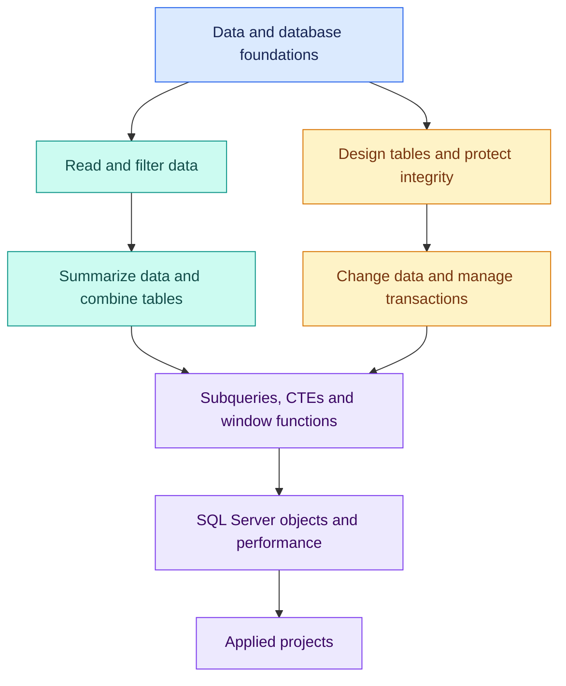

# 📘 SQL Foundations to Mastery

### A visual handbook for learning SQL with understanding.

**MICROSOFT SQL SERVER · T-SQL · PRACTICE · PROJECTS**

Understand the data. Write the query. Explain the result.

**[📚 Explore Chapters](#-explore-the-chapters)** · **[🧭 Learning Roadmap](#-the-learning-roadmap)** · **[🛠️ Study Method](#-how-i-study)**

 

**Created by Venkata Siva**

---

## 👋 Welcome to my SQL learning journey

This repository is my growing SQL handbook—from understanding what a database is to solving practical problems with Microsoft SQL Server and T-SQL.

I’m building the notes around a simple goal: **understand why a query works, not just remember its syntax.** Each topic connects a concept to sample data, a visual explanation, a query, and its result.

> [!NOTE]
> This is a learning journal, built one chapter at a time. The roadmap describes the direction of study; advanced chapters will be added as I reach them.

## 📚 Explore the chapters

Start with the foundations, then move through the chapters in order. Open a chapter folder to find its notes and available reading formats.

<!-- CHAPTER LINKS: Add one table row when a chapter folder is uploaded. Paths are relative to this root README.md and must match your actual folder names. -->

| Chapter | What it covers | Open |
| :--- | :--- | :---: |
| **01 · Data & Database Foundations** | Types of data, DBMS, RDBMS, SQL, applications, and the journey of a SELECT query | [📂 Explore](01-basics/) |
| **02 · SELECT & Filtering** | Comparisons, AND, OR, parentheses, IN, NULL, and IS NOT NULL | Next chapter |

<!-- After uploading Day 2, replace "Next chapter" with [📂 Explore](02-select-and-filtering/). Add future chapters using the same row format. -->

## ✨ Inside every chapter

| 🧠 Understand | 👀 See | ⌨️ Practise | ✅ Review |
| :--- | :--- | :--- | :--- |
| Plain-language explanations | Diagrams and relationships | Sample data and worked SQL | Explained answers |
| Why a concept exists | Query and application flows | Independent questions at the end | Common mistakes |
| Where it is useful | Expected result tables | Business scenarios and edge cases | Revision checklists |

The content grows with the topic. A foundational chapter may focus on concepts and flows, while a query chapter includes more executable examples.

### Choose your reading format

| Format | Best for |
| :--- | :--- |
| **📝 Markdown** | Reading the notes directly on GitHub |
| **🌐 HTML** | A visual browser edition with chapter-specific interactive activities |
| **📄 PDF** | Offline reading, printing, and revision |
| **💻 SQL scripts, when included** | Running setup and practice queries |

> [!TIP]
> Download an HTML chapter and open it in your browser for its reading experience. Interactive teaching examples are separate from executing SQL against a real database.

## 🧭 The learning roadmap

The foundations support two connected skills: asking good questions of data and building reliable databases. Both lead into deeper SQL Server practice.

<strong>🔎 Explore the planned topics</strong>

 

| Area | Topics |
| :--- | :--- |
| **Foundations** | Data types, databases, DBMS and RDBMS, OLTP, applications, and query execution |
| **Querying** | SELECT, WHERE, logical operators, NULL, sorting, patterns, and expressions |
| **Analysis** | Aggregates, GROUP BY, HAVING, joins, and set operators |
| **Data integrity** | Keys, relationships, constraints, and table design |
| **Data changes** | INSERT, UPDATE, DELETE, and transactions |
| **Advanced SQL** | Subqueries, CTEs, and window functions |
| **SQL Server practice** | Views, stored procedures, indexes, and execution plans |
| **Projects** | Business questions, documented assumptions, queries, and result validation |

## 🛠️ How I study

1. **Understand the question.** Identify the business need and what one row represents.
2. **Inspect the data.** Notice repeated values, boundaries, and missing facts.
3. **Predict the result.** Decide what should appear before writing SQL.
4. **Write and run the query.** Test the idea using a practice dataset.
5. **Explain the result.** Account for both included and excluded rows.
6. **Revise and practise again.** Record mistakes and solve another scenario.

> [!IMPORTANT]
> A successful query is not automatically a correct answer. Its result must match the intended question.

## 🌱 About this handbook

These notes reflect my learning and practice. I aim to keep the explanations approachable, the examples reproducible, and the assumptions clear.

The focus is **T-SQL for Microsoft SQL Server**. Syntax and behavior may differ in other database systems.

---

### Learn with curiosity. Practise with purpose.

**One chapter at a time. One clearer explanation at a time.**

[⬆ Back to the top](#-sql-foundations-to-mastery)

